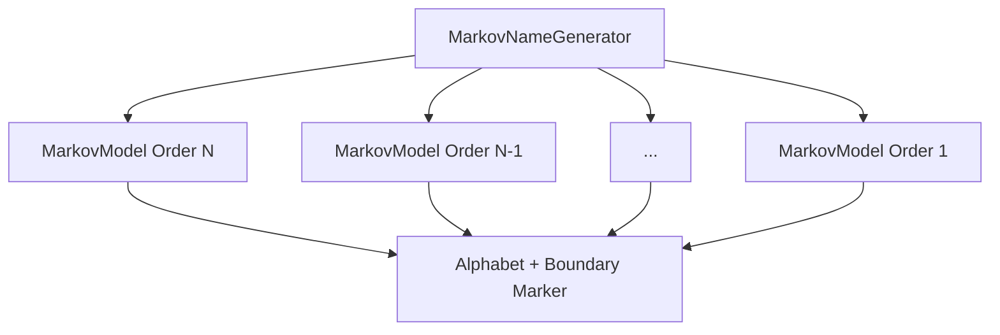
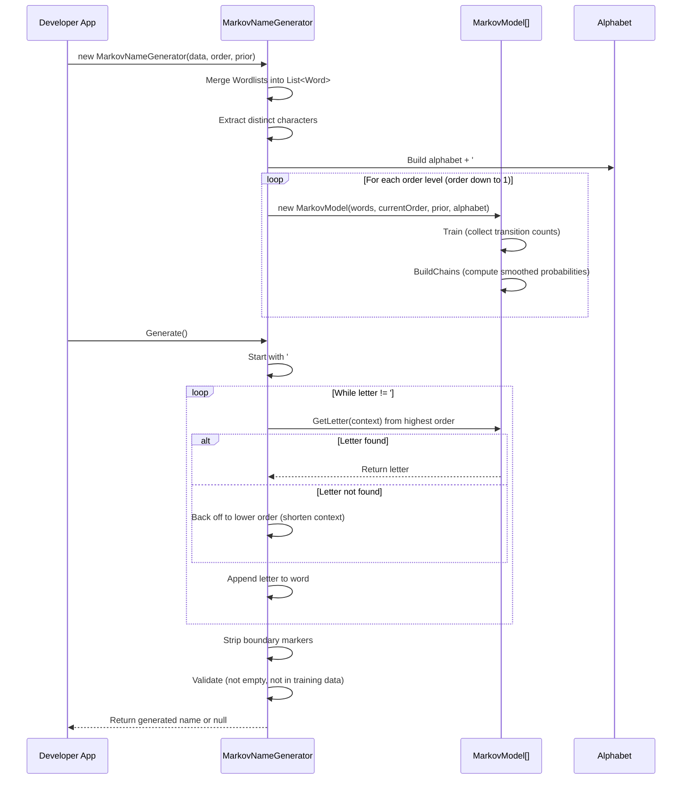
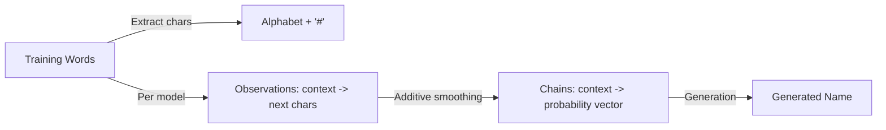
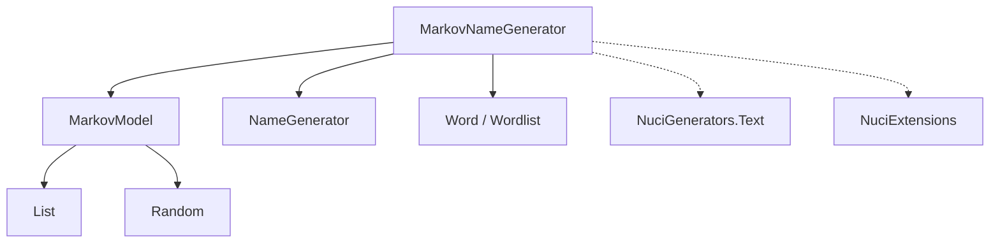

# NuciGenerators.Text.MarkovChain Architecture

This document describes the current architecture of the NuciGenerators.Text.MarkovChain library, a .NET library for Markov-chain-based name generation.

## 📑 Table of Contents

- [Purpose](#purpose)
- [System Context](#system-context)
- [Architectural Style](#architectural-style)
- [Runtime Flow](#runtime-flow)
- [Components](#components)
- [Data Architecture](#data-architecture)
- [Dependency Direction and Rules](#dependency-direction-and-rules)
- [External Dependencies](#external-dependencies)
- [Deployment and Operations](#deployment-and-operations)
- [Compatibility Contracts](#compatibility-contracts)
- [Testing and Verification](#testing-and-verification)
- [Design Constraints](#design-constraints)

## 🎯 Purpose

NuciGenerators.Text.MarkovChain is a .NET library that generates names using character-level Markov chains. It learns transition probabilities from training words provided by the developer, then generates new words that statistically resemble the training data. The library is designed for integration into applications that need procedural name generation (e.g., games, world-building tools, test data generators).

## 🌐 System Context

```mermaid
flowchart LR
    Dev[Developer Application] -->|Training Words (List<Word> / List<Wordlist>)| Lib[NuciGenerators.Text.MarkovChain]
    Lib -->|Generated Name (string)| Dev
    Lib -->|Depends on| NuciText[NuciGenerators.Text]
    Lib -->|Depends on| NuciExt[NuciExtensions]
```

The principal external boundaries are:
- **Developer Application:** Provides training data (lists of `Word` or `Wordlist` objects) and consumes generated names. Owns the training data lifecycle.
- **NuciGenerators.Text:** Provides base types (`Word`, `Wordlist`, `NameGenerator` abstract base class). Owned by the same organisation.
- **NuciExtensions:** Provides extension methods (`Repeat`, `TryGetValue`, `AddOrUpdate`, `IsEmpty`, `Pop`, `NotEquals`). Owned by the same organisation.

## 🏗️ Architectural Style

The library follows a **layered library architecture** with a single public entry point (`MarkovNameGenerator`) that encapsulates:
- A **model layer** (`MarkovModel`) representing individual n-gram order models
- A **fallback chain** of models from highest to lowest order for robust generation
- **In-memory computation** with no persistence, I/O, or external service calls



The principal architecture boundaries are:
- **Public API (`MarkovNameGenerator`):** Single entry point; exposes `Order`, `Prior`, `Data`, `Generate()`, `GetLetter()`.
- **Model Layer (`MarkovModel`):** Internal; one per order level; encapsulates training, probability building, and letter generation for a specific n-gram order.
- **Base Types (`NameGenerator`, `Word`, `Wordlist`):** From `NuciGenerators.Text`; define the integration contract.

## 🔄 Runtime Flow



The principal runtime sequence is:
1. **Construction:** Developer provides training data, order, and prior. Library merges data, builds alphabet, constructs fallback model chain.
2. **Training (per model):** Collect n-gram transition counts from training words with boundary markers.
3. **Chain Building (per model):** Compute additive-smoothed probabilities for each context-alphabet pair.
4. **Generation:** Start with boundary context; iteratively query models from highest to lowest order; back off on missing contexts; stop at end boundary; validate and return result.

## 🧩 Components

| Component | Responsibility | Principal Dependencies | Lifetime or Ownership |
|-----------|----------------|------------------------|-----------------------|
| `MarkovNameGenerator` | Public entry point; orchestrates model chain; exposes generation API | `List<MarkovModel>`, `NuciGenerators.Text.NameGenerator`, `NuciGenerators.Text.Models.Word` | Created by developer; lives for generation session |
| `MarkovModel` | Encapsulates single-order Markov chain: training, probability building, letter generation | `Dictionary<string, List<string>> observations`, `Dictionary<string, List<float>> chains`, `List<string> alphabet`, `Random` | Owned by `MarkovNameGenerator`; one per order level |
| `NameGenerator` (base) | Abstract base from `NuciGenerators.Text`; defines `GenerationAlgorithm()` contract | None (in this library) | Inherited by `MarkovNameGenerator` |
| `Word` / `Wordlist` | Data transfer types for training input | None (in this library) | Provided by developer; read-only during construction |

## 💾 Data Architecture



| Data or Store | Owner | Representation and Storage | Lifecycle or Consistency |
|---------------|-------|----------------------------|--------------------------|
| `Training Words` | Developer | `List<Word>` or `List<Wordlist>` (in-memory) | Provided at construction; read-only |
| `Alphabet` | `MarkovNameGenerator` | `List<string>` (distinct characters + `#`) | Built at construction; immutable |
| `Observations` | `MarkovModel` | `Dictionary<string, List<string>>` (context -> observed next chars) | Built during `Train()`; immutable after |
| `Chains` | `MarkovModel` | `Dictionary<string, List<float>>` (context -> probability per alphabet symbol) | Built during `BuildChains()`; immutable after |
| `Generated Name` | `MarkovNameGenerator` | `string` | Returned per `Generate()` call; no persistence |

## 🧭 Dependency Direction and Rules



The principal dependency rules are:
- `MarkovNameGenerator` depends on `MarkovModel` (composition), `NameGenerator` (inheritance), and data types from `NuciGenerators.Text`.
- `MarkovModel` depends only on BCL collections, `Random`, and the alphabet provided by `MarkovNameGenerator`.
- No circular dependencies. `MarkovModel` has no knowledge of `MarkovNameGenerator`.
- External dependencies (`NuciGenerators.Text`, `NuciExtensions`) are used only at the `MarkovNameGenerator` boundary.

## 📦 External Dependencies

| Dependency | Responsibility | Integration Boundary | Architectural Consequence |
|------------|----------------|----------------------|---------------------------|
| `NuciGenerators.Text` (1.0.1) | Base types: `NameGenerator`, `Word`, `Wordlist` | `MarkovNameGenerator` inherits `NameGenerator`; consumes `Word`/`Wordlist` | Couples public API to external package version; breaking changes in base types require library update |
| `NuciExtensions` (5.3.1) | Extension methods: `Repeat`, `TryGetValue`, `AddOrUpdate`, `IsEmpty`, `Pop`, `NotEquals` | Used throughout `MarkovNameGenerator` and `MarkovModel` | Couples implementation to extension method signatures; source available for fork if needed |

## 🚀 Deployment and Operations

| Concern | Current Design | Architectural Consequence |
|---------|----------------|---------------------------|
| **Distribution** | NuGet package (`NuciGenerators.Text.MarkovChain`) | Consumers reference via `dotnet add package`; no runtime deployment |
| **Process Topology** | In-process library; no separate process | No scaling, availability, or recovery concerns |
| **Persistent State** | None | No migrations, backups, or state management |
| **Resource Use** | In-memory dictionaries proportional to training data size × order | Large training sets or high orders increase memory; developer controls input |
| **Thread Safety** | Not thread-safe (`Random` per model, mutable dictionaries during construction) | Developer must synchronise if sharing instances across threads |

## 🛡️ Compatibility Contracts

| Contract | Owner | Invariant | Verification | Change Policy |
|----------|-------|-----------|--------------|---------------|
| `MarkovNameGenerator` public API | `MarkovNameGenerator` | Constructor signatures, `Order`, `Prior`, `Data`, `Generate()`, `GetLetter()` | Unit tests in `NuciGenerators.Text.MarkovChain.UnitTests` | Semantic versioning; breaking changes require major version |
| `NameGenerator` base contract | `NuciGenerators.Text` | `GenerationAlgorithm()` returns `string` or `null` | Not directly tested here | Depends on upstream package |
| Training data format | Developer | `Word.Id` + `Word.Values` (list of strings) | Not enforced by library | Developer responsibility |

## ✅ Testing and Verification

The library includes a unit test project (`NuciGenerators.Text.MarkovChain.UnitTests`) using NUnit 4.x + Moq.

Execute the principal automated verification with:

```bash
dotnet test
```

Test coverage includes:
- Constructor parameter retention (`Order`, `Prior`, `Data`)
- Deterministic generation with zero prior (reproduces training word)
- Letter-level transition verification for known contexts
- Fallback/back-off behaviour implicitly tested via generation

Material coverage gaps:
- No tests for multi-word training sets
- No tests for higher-order models (order > 1)
- No tests for smoothing behaviour with non-zero prior
- No thread-safety tests
- No boundary-condition tests (empty training data, single-character words)

## ⚠️ Design Constraints

- **In-memory only:** No persistence, streaming, or incremental training. Entire training set must fit in memory.
- **Single-threaded `Random`:** Each `MarkovModel` owns a `Random` instance; not safe for concurrent `Generate()` calls on shared instance.
- **No cancellation:** Generation loops have no `CancellationToken` support; long-running generation (large order, large alphabet) cannot be interrupted.
- **Fixed alphabet:** Alphabet derived solely from training data at construction; cannot generate characters not seen in training.
- **Validation logic:** `GenerationAlgorithm()` rejects empty results and results matching training data; this behaviour is hardcoded and not configurable.
- **TODO in code:** `MarkovModel.Train()` has a `TODO` comment questioning `AddOrUpdate` behaviour for duplicate keys.
- **Typo in method name:** `GenerationAlogrithm` (missing 'i') in override; cannot be fixed without breaking base contract if base has same typo.